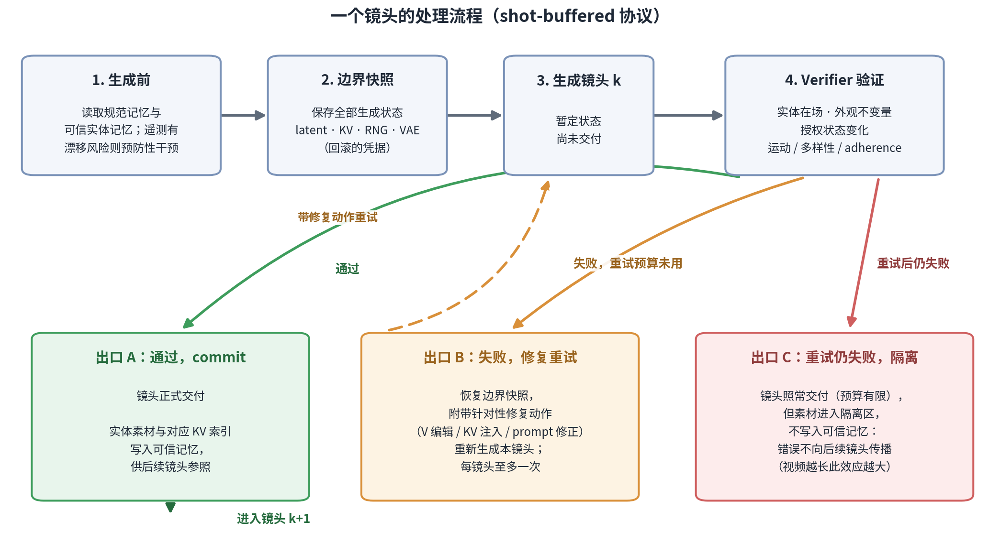

# Agentic 系统说明：如何利用已验证的 V 编辑通道

2026-07-16 · 前篇：[V 编辑通道解释](capsule_pilot_20260715/CHANNEL_TEST_EXPLAINED.zh.md) ·
工程规格：[Agentic Boundary Runtime v1 goal](agentic_boundary_runtime_codex_goal.md)

## 一、现状

通道实验证明：在镜头边界原位修改注意力缓存中实体区域 token 的 V 向量（V 向量存放
每帧的内容表征），能大幅改变后续生成，并推动主体一致性指标（最大 ±0.09，门槛 0.01
的 9 倍）。但改变的方向不受控：同一操作在不同镜头上有正有负。

接下来的 agentic 系统回答四个问题：**什么时候需要干预（When）、哪个实体哪条约束出了
问题（What）、干预模型内部的哪个位置（Where）、用哪种操作和多大强度（How）**——
并且提供撤销机制（快照回滚）。

## 二、系统组成

| 组件 | 职责 |
|---|---|
| **State Compiler**（VLM） | 生成开始前，从剧本（global.json + 逐 shot JSON）提取实体清单、外观不变量、每个镜头允许/禁止的状态变化，写入规范记忆 |
| **Observer** | 每个镜头生成后，采集低分辨率帧、实体 crop、模型内部遥测（注意力分布、KV 统计） |
| **Verifier**（VLM + 数值 guard） | 对照规范记忆检查：实体是否在场、外观是否符合不变量、授权状态变化是否发生、运动/多样性/adherence 是否达标 |
| **Controller** | 根据 Verifier 的结论从固定工具箱中选择动作：接受、修复后重试、或接受但隔离 |
| **三类记忆** | 见第四节 |

## 三、一个镜头的处理流程

第三个出口是本设计中最容易被低估的部分：预算耗尽时坏镜头只能交付，但**隔离它的
素材可以阻止错误进入记忆**。后续镜头不会以错误素材为参照，错误不会随镜头数累积
放大。这个效应随视频长度增长。

## 四、三类记忆及其写入规则

| 分区 | 内容 | 写入规则 |
|---|---|---|
| **规范记忆** | 剧本编译出的实体、不变量、允许的状态变化 | 生成开始后只读；生成结果不能反写 |
| **视觉记忆** | 通过验收镜头的实体 crop、embedding、mask | 仅在镜头 commit 时写入；隔离镜头的素材禁止写入 |
| **模型原生记忆** | 可信帧对应的 KV/V 条目、token/region 索引、层信息 | 与视觉记忆同步写入/隔离；是干预动作的操作坐标 |

分区只读/验收写入的规则针对一个已发生过的真实故障：Round 17 中,优化器观察到
baseline 渲染里凭空出现的人物,试图将其写入全局不变量——被独立审查门拦截。若无
拦截,后续所有镜头会持续保持这个错误。规范记忆只读 + 视觉记忆验收制,就是把这条
防线做成结构性约束。

## 五、工具箱

Controller 不直接生成张量,只能从固定工具集选择,参数域有界,每次调用记录输入指纹、
参数、理由与结果:

| Verifier 的结论 | 动作 | 说明 |
|---|---|---|
| 文本不变量未被遵循 | `patch_prompt(invariant)` | 只允许追加,须过审查门 |
| 实体缺失 | `inject_entity_kv(entity, boundary)` | 将可信记忆中该实体的 KV 条目追加进注意力上下文 |
| 实体在场但外观漂移 | `steer_v(entity, layers, alpha)` | 通道实验验证的原位 V 编辑:把窗口内该实体 token 的 V 向可信原型插值 |
| 场景布局漂移 | `inject_scene_anchor_kv(boundary)` | 场景级锚帧注入 |
| 历史条目被注意力降权 | `rope_remap` / `logit_bias(λ)` | 调整注入条目的位置编码或注意力偏置 |
| 当前镜头不可信 | `quarantine(shot)` | 素材不写入可信记忆 |
| 严重失败且预算未用 | `restore_and_retry(actions)` | 恢复边界快照重试,每镜头至多一次 |
| 诊断置信度不足 | `abstain()` | 不干预,记录理由。误干预的代价高于不干预 |

## 六、 LongLive-RAG（arXiv 2606.02553）
**LongLive-RAG**:把自生成的历史 latent 当作
可检索记忆,每个 block 用上一个完成 latent 的嵌入检索 top-K 历史条目,**拼接**进
注意力上下文(`A = [sink ‖ 检索条目 ‖ 局部窗口]`);生成器冻结,只训练检索嵌入
(自编码器 + Window Temporal Delta Loss)。在单 prompt 连续长视频(30–120s)上
取得 VBench-Long 最佳平均排名。

与本系统的关系:

- **机制类别不同**:该论文是**追加式**——检索决定给模型看哪段历史,模型自行决定
  注意多少;我们的核心动作(V 编辑)是**原位改写**——直接修改窗口内已有条目的内容。
  我们 Round 13–18 的实验表明,在跨镜头场景切换的设定下,追加的异源条目被注意力
  降权 4–20 倍;该论文的正结果来自同场景连续生成——检索内容与当前画面同源,
  注意力天然会看。两组结果共同划出一个边界条件:**追加式检索适用于同场景误差累积,
  跨镜头实体修复需要改写而非追加**。
- **无验收控制**:该论文检索到什么就注入什么,漂移的历史也可能被检回;本系统的
  verifier 准入 + 隔离区正是补这个缺口。
- **无诊断,无实体粒度**:该论文每 block 无条件检索,latent 块级粒度;本系统按诊断
  触发,实体区域 token 级粒度。
- **命名冲突**:本 repo 与该论文同名,后续论文中我们的方法需改名并引用它。

**正式实验中要与它比较的项目**(详细清单见 goal 文档 §7):

1. 把它的开源实现作为 baseline 接入我们的多镜头 benchmark——检验训练过的检索嵌入
   +追加注入在跨镜头实体重现设定下是否有效(我们的预测:受限);
2. 同一追加机制下,它的训练检索器 vs 我们的 VLM 语义选择——隔离"选择质量"的贡献;
3. 相同参照帧下,追加注入 vs 原位 V 编辑——隔离"机制类别"的贡献;
4. 双 regime 报告:单 prompt 连续(它的主场)与多镜头切换(我们的主场)各报一组,
   验证上述边界条件主张;
5. 记忆卫生消融:无准入的检索池 vs 验收过滤的检索池;
6. 指标双轨:VBench-Long(与它可比)+ 实体级指标(我们的主尺);同时报告开销
   (它 4.08 ms/block,我们的 probe/VLM 成本)。

## 七、预期管理:凭什么胜过简单方法

主要质疑:"验证后重试一次,与直接多采样几条选最好的(best-of-N)相比优势何在?"

诚实回答:单镜头修复率上未必有优势。本系统的预期优势在两处:

1. **诊断条件化的重试命中率更高**:已定位失败原因(如"外观漂移")的重试携带针对性
   修正动作,盲重采只是更换随机数;
2. **隔离区的长程效应**:best-of-N 选完即止;本系统额外阻止坏素材进入记忆,错误
   不向后传播。视频越长,该效应越大。

因此正式实验的判定标准是:agent 必须**同时**优于静态策略和等算力盲重采,只优于
baseline 不算数;且主要展示场景应是长视频。

## 八、执行顺序

1. **工程闭环(当前 goal)**:验收标准全部是无害性——功能关闭时与现行生成逐位一致、
   快照回滚数值等价、隔离生效、无未来信息泄漏、账本可复现。不允许任何质量主张;
2. **动作可靠性研究**:扫描 V 编辑的强度、参照选择、层组合,配合实体掩码指标,
   使动作方向可预期;
3. **正式对比**:baseline / 静态策略 / prompt-only / LongLive-RAG(论文)/
   model-native agent / 等算力重采,gate 预先注册。

## 附:相关文档

- 工程规格:[agentic_boundary_runtime_codex_goal.md](agentic_boundary_runtime_codex_goal.md)
- 通道实验解释:[CHANNEL_TEST_EXPLAINED.zh.md](capsule_pilot_20260715/CHANNEL_TEST_EXPLAINED.zh.md)
- 学术版计划(对照矩阵与统计协议):[multiview-consistency-research-plan.zh.md](multiview-consistency-research-plan.zh.md)
- LongLive-RAG 论文:arXiv 2606.02553,代码 github.com/qixinhu11/LongLive-RAG
