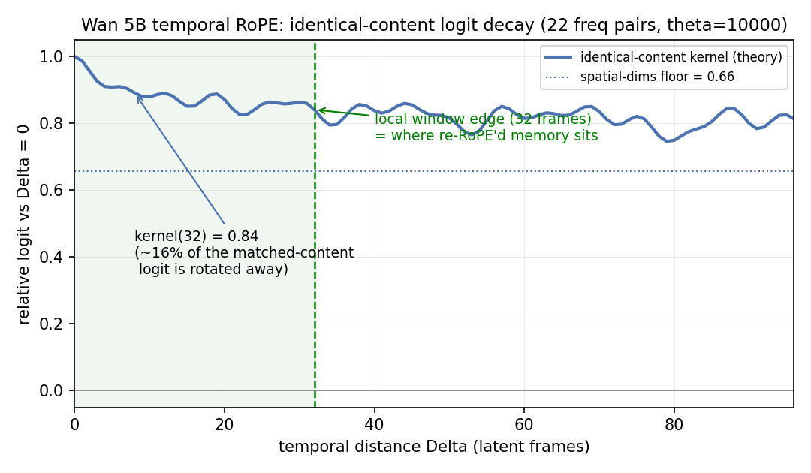
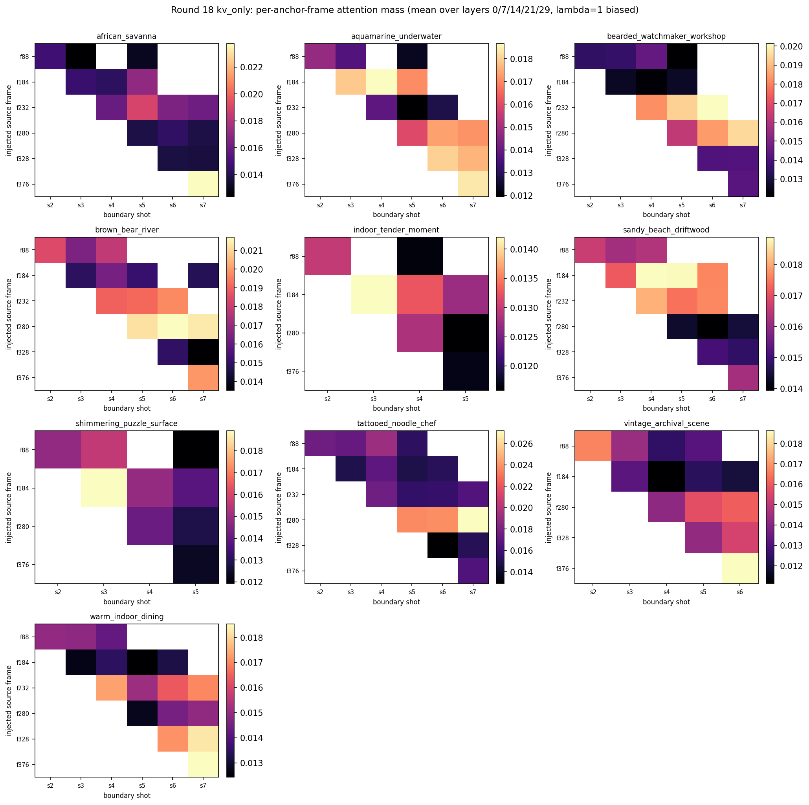
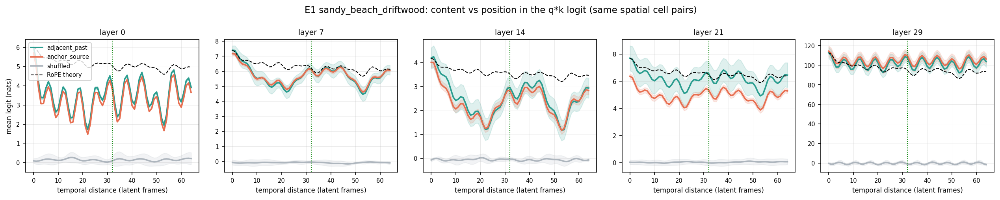
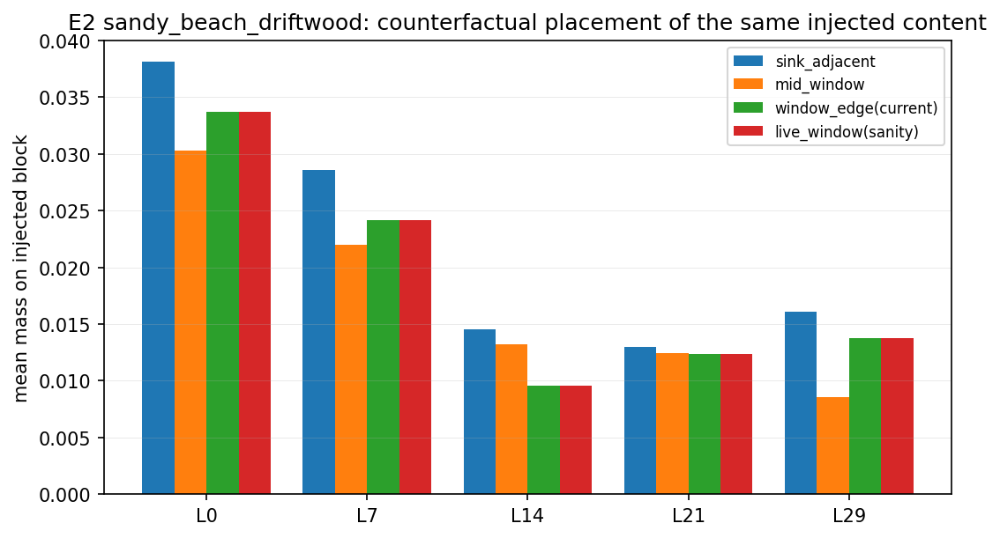
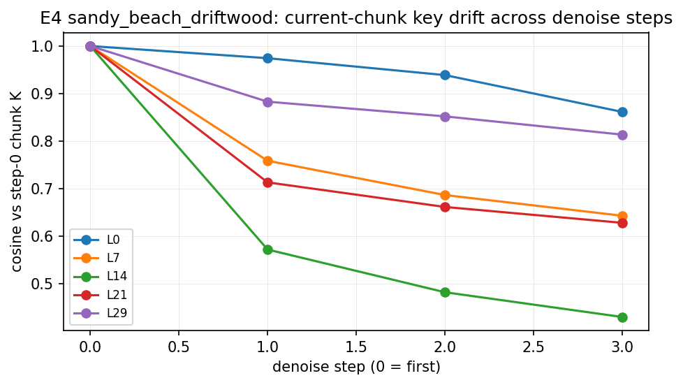
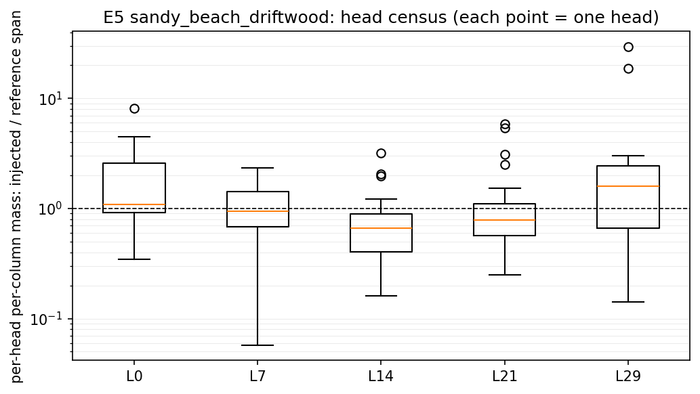
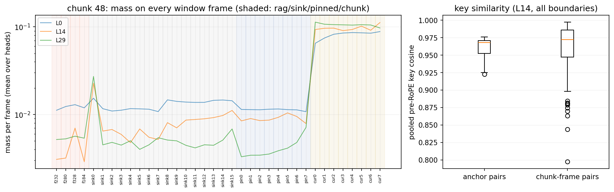
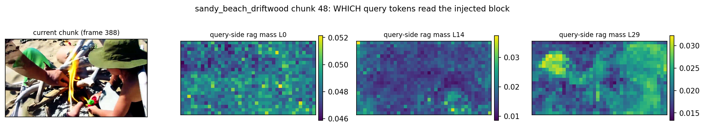

# 注入记忆列为什么被注意力降权：测量笔记

2026-08-20。组会上提到跨镜头场景下 attention 明显降权,这份笔记把这个现象当成一个
可分解的测量问题来做:降权到底是位置造成的、内容造成的、还是训练出来的习惯,
每一部分各占多少,量出来之后哪一部分是可修的。

当天全部做完了:先用已有数据出了三张零渲染的图,下午 GPU 空出后自动跑完
带探针的重放(2 场景、18 分钟),五个离线分析当晚出齐。结论在最后两节——
一句话预告:降权的主因不是"外来列被歧视",而是当前 chunk 的自注意力垄断,
这把改进的重心进一步推向改写(V-edit / editing)路线。

## 起点:四个互相咬合的数字

之前三轮实验各自量过注入记忆的消费情况,放在一起看是这样:

| 出处 | 设定 | 注入列拿到的注意力 |
|---|---|---|
| Round 14 | 跨镜头 anchor,追加在窗口前 | 1–3%,均匀线应为 6–13%,降权 4–20 倍 |
| Round 18 | 同上,外加 λ=1 的 logit 偏置 | mass 从 0.017 抬到 0.041,但一致性没跟着变 |
| sameshot 实验 | 同场景检索帧,放在 sink 相位 | 19%,约均匀线的 0.4 倍 |
| sameshot 区域探针 | 同上 | 主体和背景 token 的消费密度比 1.01,读的是场景统计量 |

对比第一行和第三行:同场景内容放在 sink 位置基本被正常消费,跨镜头内容放在
窗口边缘被压到几十分之一。但这两行之间差了两个变量——内容(同场景 vs 跨镜头)
和位置(sink 相位 vs 窗口边缘)——哪个变量贡献多少,现有数据回答不了。
这就是本研究要拆的东西。

一个换算先记住:softmax 下,mass 差 20 倍只对应 logit 差 ln(20) ≈ 3。
所以所有分解都在 logit 空间做,那里的缺口是加性的,能一项项归因。

## 注入机制在代码里长什么样

读代码确认的事实,后面所有分析都建立在这上面:

- 检索/场景记忆存的是打 RoPE 之前的 key([kv_rag.py:112](../utils/kv_rag.py#L112)
  的 `virtual_frame_start`)。注入时重新打上 RoPE,放到紧贴 local window 之前的
  虚拟帧位上——这样 query 和记忆的相对距离落在训练分布之内。所有 round 的配置
  里 `reinject_rope` 都是开着的,所以 Round 14/18 测到的 4–20 倍降权**不是**
  位置越界造成的,记忆列的位置是合法的。
- 注意力窗口的拼接顺序是 [注入块 ‖ sink ‖ pinned ‖ local]
  ([causal_model.py:842](../wan_5b/modules/causal_model.py#L842))。
- local window 是 32 个潜帧(约 5.3 秒),训练时窗口里永远是真实连续的最近过去。
  所以"紧贴窗口之前"这个位置,在模型的经验里对应的是 32 帧前的连续内容——
  正好是它见过的最远距离。
- sink 是最前面的 8 帧,streaming 训练时常驻可见,模型对这个槽位有专门学出来的
  行为。

## 今天出的三张图(零渲染)

### 图一:纯 RoPE 旋转解释不了降权

先排除一个最省事的解释:"RoPE 对远距离有天然衰减,注入块放得远所以 logit 低"。
这个衰减可以零参数地算出来:对内容完全相同的一对 q/k,旋转到相隔 Δ 帧之后,
logit 还剩多少。Wan 5B 每个头 128 维里只有 44 维随时间旋转,剩下 84 维是空间
维,根本不动。

结果:在 32 帧处(注入块所在的位置),匹配内容的 logit 只掉了 16%。假设 logit
本身是几个 nat 的量级,16% 远远凑不出 3 个 nat 的缺口。**几何衰减不是主因**;
如果测量(E1)显示真实衰减远陡于这条理论线,多出来的部分就是训练学出来的
recency 偏好,写在 q/k 的统计结构里,而不是写在旋转几何里。
(脚本:`scripts/plot_rope_temporal_kernel.py`)

### 图二:降权随深度单调加重,浅层根本没降权

Round 18 的诊断数据里每个 boundary 落了逐层逐帧的 mass 记录,一直没人画过。
画出来是全场一致的结构:

九个场景没有例外:layer 0 精确贴着均匀消费线走,往深走消费越来越少。
后来带探针的 λ=0 重放(下一节)给出了无偏数字,和 λ=1 的对照放在一起:

| layer | 0 | 7 | 14 | 21 | 29 |
|---|---|---|---|---|---|
| λ=1(Round 18,9 场景) | 0.9× | 1.8× | 2.8× | 2.2× | 4.2× |
| λ=0(重放,driftwood) | 2.3× | 4.9× | 10.3× | 5.1× | 10.6× |
| λ=0(重放,watchmaker) | 2.3× | 4.7× | 8.3× | 7.8× | 10.5× |

两个场景的 λ=0 数字几乎重合,结构很稳。λ=1 对 λ=0 的比值约 2.6 ≈ e,
正是理论预期的偏置效果——所以"浅层无降权"是偏置抬出来的假象,真实情况是
**所有层都在降权(浅层 2.3 倍),深度再把它放大到 10 倍**。

两个推论。第一,降权不是一个全局常数,是深度的函数——任何"给注入列加个统一
偏置"的补救(Round 18 的 λ=1 就是)都在错误的粒度上使劲:λ=1 把浅层补到了
均匀线,深层还欠着 4 倍。第二,G1 实验测出身份信息最可解码的层是 layer 14,
而它无偏降权 8–10 倍,和最深层并列最重:**载身份的层恰恰是最不读记忆的层**。
"喂错了层"从猜想变成了有数据的现象。

有一个诚实的保留:layer 0 贴均匀线未必说明浅层在"认真读"记忆——早层注意力
本身可能就接近均匀,任何列都能拿到均匀份额。所以后面的分析里,参照系一律从
"均匀线"换成"同距离的真实 local 列":同一层里注入列和它旁边真实列的差,
才是干净的"异物折扣"。(脚本:`scripts/plot_injected_attention_mass.py`)

### 图三:注入块内部,读哪一帧基本无差别

同一批数据还能回答:一个 boundary 注入最多 4 个 anchor 帧,模型偏爱哪个?

答案是基本不挑:同一列内各 anchor 帧的 mass 差异在 ±30% 以内,远小于层间的
几倍差距。这和区域探针的 1.01 是同一件事的两面——模型对注入内容的消费是
无差别的,既不挑帧,也不挑主体区域。想让"选得准的 anchor"发挥作用,先得让
模型有差别地读,否则选择精度是白费的。
(脚本:`scripts/plot_injected_frame_consumption.py`)

## 带探针的重放(已完成)

logit 级的分解需要 q 和 k 的原始张量,而 pilot 的 dump 只存了 V。所以给
kv_rag 加了一个只读探针(`attn_probe`,[kv_rag.py](../utils/kv_rag.py) 配置
`attn_probe_dir` 触发):每次注入注意力调用落盘采样的 pre/post-RoPE query、
注入块的 pre-RoPE key、整个拼好的窗口 K、每个 denoise step 的当前 chunk K,
store 侧再存每个 chunk 的 clean-recache 全量 K 和 RoPE 频率表。离线数学用
合成数据验证过:离线重放置的 mass 和真实窗口对到小数点后五位。

当天下午卡空出来,watcher 自动在 tmux 里跑完 driftwood + watchmaker 两个场景
(λ=0 无偏置,其余与 Round 18 kv_only 相同;18 分钟,dump 各 26GB,在
`videos/attn_probe_20260820/`)。两个场景所有测量几乎重合,下面的数字默认取
driftwood,watchmaker 的对应值在括号或 JSON
(`docs/figures/attention_downweighting/*_analysis_summary.json`)里。

## 重放测出来的东西:降权的真实结构

先交代一个意外:分解的结果和进场时的直觉相反。我们进场时的问题是"模型为什么
歧视外来列",测完发现**外来列基本没有被歧视——被所有旧内容共同竞争不过的,
是正在生成的当前 chunk 自己**。逐条说。

### 主导项:当前 chunk 的自注意力垄断

E3 把 boundary 处窗口的四个区段(注入块/sink/pinned 锚/当前 chunk)分开算
平均 logit 和实际 mass:

当前 chunk 拿走 66%(L0)到 84%(L29)的注意力 mass,logit 比任何旧内容高
1.5–2.5 个 nat——换成 mass 就是每列 5–12 倍的优势。剩下的零头才由 sink、
pinned、注入块去分。逐 boundary 算"每个区段拿到的 mass / 它自己的均匀份额"
(中位数):

| | 注入块 | sink | pinned |
|---|---|---|---|
| L0 | 0.44 | 0.47 | 0.41 |
| L14 | 0.12 | 0.30 | 0.29 |
| L29 | 0.18 | 0.26 | 0.14 |

L0 一行是关键:三种旧内容被压到完全相同的程度(≈0.44,即 2.3 倍)——
**浅层对外来内容的折扣是零**,"4–20 倍降权"在这里全部由 recency 垄断构成,
它同等地压着模型自己的 sink 和 pinned。中层不同:L14 的注入块比 sink/pinned
还要再低 2.5 倍左右——这一层确实存在内容折扣,而且大小和下一节"同槽位内容差
0.76 nat"(e^0.76 ≈ 2.1 倍)定量吻合,两个独立测量互相印证。L29 的注入块和
pinned 相当。

### 深度梯度的来源:深层在按内容挑时近的

同一个 rag 槽位上,把时间相邻的内容(上一个 chunk 的 clean K)离线转进去和
实际的旧 anchor 内容比,logit 差从 L0 的 0.02 nat 单调涨到 L29 的 0.86 nat
(watchmaker 0.83)。浅层对内容新旧无感,深层明显偏好时近内容——这就是图二
里降权随深度加重的来源。E1 的距离衰减曲线补上另一半:

学习出的距离衰减集中在 layer 14(20 帧内掉约 2.5 个 nat,远陡于 RoPE 理论
虚线),L29 则完全平坦——最深层不看位置,只看内容和下面这条。打乱内容的
对照全层归零,说明曲线全部由真实内容承载。L0 有一个 8 帧周期的振荡,
恰好是 num_frame_per_block,浅层在编码块内相位。

### 位置手术的杠杆:小

E2 把同一块注入内容离线搬到三个位置重算 mass:sink 相邻位置最多 +47%
(L14,0.0096→0.0145),其余层 +13–18%,mid-window 反而更差。位置不是
主轴;同场景检索在 sink 相位拿到 19% 的那个结果,应主要归因于内容相似,
而不是槽位特权——把外来内容放到 sink 旁边并不能继承 sink 的待遇。

### 两个和 denoise 过程有关的新现象

一,L29 对注入块的消费随 denoise step 单调衰减:0.0138 → 0.0070 → 0.0043
→ 0.0034,四步掉 4 倍;L0 和 L14 全程平稳。画面越成形,最深层越不看记忆。
二,E4 显示当前 chunk 的 K 在 denoise 四步之间变化剧烈,以 L14 为最
(step3 对 step0 的余弦只有 0.43)——存储时的 clean 相位和查询时的噪声相位,
在中层是两种明显不同的表征。想让记忆被中层读懂,存储相位可能得匹配。

### 头普查:异质性巨大,记忆头存在

逐头的"注入列 per-column mass / pinned 参照"跨越 0.06 到 30 倍。L29 有两个
头在 18–30 倍——它们几乎只读注入块;L14 的中位头在 0.65,即身份层的典型头
确实低于参照。层平均掩盖了这么大的结构,任何头级定向干预都有真实的靶子。

### 追问:为什么注入的几个帧拿到的注意力几乎一样多?

先把词定义清楚:这里说的"权重"就是 softmax 之后的注意力——把一个注入帧的
880 个 token 列收到的注意力加起来,对全部 query 和 24 个头取平均。图三里
"帧间差异 ±30%"说的就是这个量。为什么会这么平?用原始 Q/K 在 token 级重算
(全量 query,GPU),答案分三层。

第一层:**不是模型读得无差别,是这些帧在它眼里本来就是同一个东西。**
把每个 anchor 帧的 key 池化成一个向量算两两余弦,anchor 之间是 0.958——
和同一个 chunk 里相邻两帧之间的 0.961 一样高(watchmaker:0.940 vs 0.938)。
同场景不同时刻的帧,在池化 key 层面几乎重合,因为背景主导了池化特征。
模型按内容相似度打分,相似的输入自然拿相似的分:anchor 间的 logit 差只有
0.26–0.43 nat,e^0.3 ≈ 1.35,恰好就是观测到的 ±30%。反过来,整个窗口内
帧间 logit 差有 2.7–9 nat——模型对帧的分辨能力很强(当前 chunk 高出一切、
sink 第一帧有标志性尖峰),只是 anchor 之间确实没什么可分辨的。一个例外
印证了这套逻辑:L14(内容-时近层)给最近的 anchor f328 的 mass 是其他
anchor 的 2.3 倍——当输入真有差别(时近性)时,会挑的层就挑了。

第二层:**帧内部的读取方式,各层完全不同,而且都不看主体。** 把一个注入帧
每个 token 收到的注意力铺回 22×40 网格,和视频帧并排:

L0 是弥散的、大致跟着纹理走;L14 是"枢纽 token"式——整帧近乎全黑,只有
一两个 token 亮到均值的 40–100 倍,中层把整帧压缩成一两个汇聚点来读,
而这些枢纽不落在主体(鱼)上;L29 是均匀噪点。**没有任何一层的注意力描出
主体的轮廓。** 区域探针那个 1.01 的密度比,在这里变成了直接可见的图像:
主体 token 的 V 几乎不被混进生成,身份信息在读取端就漏掉了——这就是
"为什么注入修不了身份"的最底层机械图景。

第三层:query 侧也有结构。哪些正在生成的 token 在读记忆?浅层完全均匀,
深层有清楚的空间分块(L29 某些区域的读取强度是别处的 2–3 倍):

对干预的含义:帧选择没有杠杆(第一层),但**token 级是有杠杆的**——L14 的
枢纽赢家通吃说明,把区域 logit bias 加在主体 token 上、对抗枢纽 token,
是追加式路线里还没试过且现在有明确靶子的一招。当然,这仍然在 recency
垄断的小盘子里操作,上限由上一节决定。
(脚本:`scripts/analyze_injected_frame_structure.py`,两场景数字一致,
watchmaker 的图和 JSON 同目录。)

## 这组测量改变了什么

预注册判定树落在了一个进场时没写的分支上,老老实实展开:

**"修位置"和"修选择"两条路正式关闭。** 位置手术离线上限 +47%,render 臂
不值得跑了(留一个 1–2 render 的抽查确认即可);选择质量在图三和 E5 之前就
被排除。校准偏置也降级:要补的缺口是对当前 chunk 的 2 个 nat,强行补会直接
和自注意力抢 mass,风险在破坏去噪本身——而 λ=1 的先例已经说明 mass 上去了
一致性也不动。

**追加式路线的天花板现在有了机制解释。** 记忆列在浅层与模型自己的旧内容
待遇完全相同,中层多付一层约 2.5 倍的内容折扣,但真正的天花板是 softmax
的零和:当前 chunk 的 recency 垄断结构性地把所有旧内容(包括模型自己的
sink 和 pinned)压在 15–35% 的总盘子里。往里追加更多、更准、位置更好
的记忆,都是在这个小盘子内部重新分配。这与 LongLive-RAG 的边界条件互恰:
同场景检索有效,因为它要的就是"场景统计量提示",小盘子够用;跨镜头身份修复
要的是强约束,小盘子给不起。

**写入路线拿到最强的一次背书。** 要绕开 recency 垄断,唯一不和 softmax
竞争的办法就是让"当前 chunk 自己"携带正确身份——改写(V-edit / editing
工具 + recache)恰好是这个形状:修复后的内容就是下一个"当前 chunk"的历史,
享受垄断而不是对抗垄断。(后续:改写执行器的第一个实验当天完成,零外部
模型的 masked renoise 通道成立,见
[sdedit-repair-pilot.zh.md](sdedit-repair-pilot.zh.md)。)

**留给追加式的两个真靶子,都便宜。** 一是时机:L29 的 step 衰减说明记忆
影响窗口在最初一两个 denoise step,任何注入/引导应该前移到 step 0–1,而
不是全程摊开;二是头定向:E5 的 18–30 倍记忆头是现成的注入目标,配合 L14
的相位匹配存储(E4)可以做一个小而干净的"定向注入"臂。这两个可以合成一个
2–4 render 的验证轮,作为追加式路线的最后一搏,输了就彻底归档。

## 文献锚点

- RoFormer(arXiv 2104.09864)§3.3:RoPE 内积长程衰减——图一的理论出处,
  本笔记的测量正是要看真实衰减比它陡多少。
- StreamingLLM(arXiv 2309.17453):attention sink 槽位——E2 检验的现象。
- Retrieval Head(Wu et al., arXiv 2404.15574):检索能力集中于少数头——E5 的
  方法参照。
- LongLive-RAG(arXiv 2606.02553):sink 相位注入 + 同场景检索有效的对照系统;
  本研究解释它为什么同场景成立、跨镜头失效。
