# 追回红鲷鱼:注意力机理与修复通道(汇报版)

2026-08-20,branch `feat/multiview-consistency`。一条在第五个镜头里褪色的红鲷鱼,
牵出注意力机制的完整分解、六轮历史失败的机理解释,和第一个验证成立的修复通道。
一个 GPU 日,三个互相咬合的结论:

| 数字 | 含义 |
|---|---|
| **70–85%** | 注意力被"正在画的当前块"垄断——降权的真因,不是外来内容被歧视 |
| **+0.066** | 擦掉重画(σ=0.94)的身份修复量,约收回与金帧差距的 1/4,零外部模型 |
| **1–2 块** | 修复自由传播的半衰期——不能靠传播,必须逐块修 |

详细过程分别在 [attention-downweighting-study.zh.md](attention-downweighting-study.zh.md)
和 [sdedit-repair-pilot.zh.md](sdedit-repair-pilot.zh.md);本文是可直接汇报的浓缩版,
外加 MovieGenBench(LongLive-RAG 论文用的 benchmark)上的例子对比。

## 问题

长的多镜头视频里,主角在镜头切换后慢慢变样。过去六轮实验(Round 13–18)都在
尝试同一类修法——把之前镜头的画面记忆(KV)塞进注意力窗口提醒模型——全部
无效,且不知道为什么。上周会议定下方向:把 editing 作为工具写进 pipeline。
本次先回答"为什么塞不进",再验证"怎么修"。

## Part 1:为什么塞进去的记忆没被用

给推理管线加了只读探针,把注入注意力调用的原始 Q/K 全部落盘(2 场景、52GB),
离线做 logit 级分解——离线重放置和真实窗口的注意力质量对到小数点后五位。

结构在所有场景一致——冻结 benchmark 的 9 个场景无一例外,注入记忆的消费量
随网络深度单调下降(浅层贴均匀线走,深层压到十分之一):

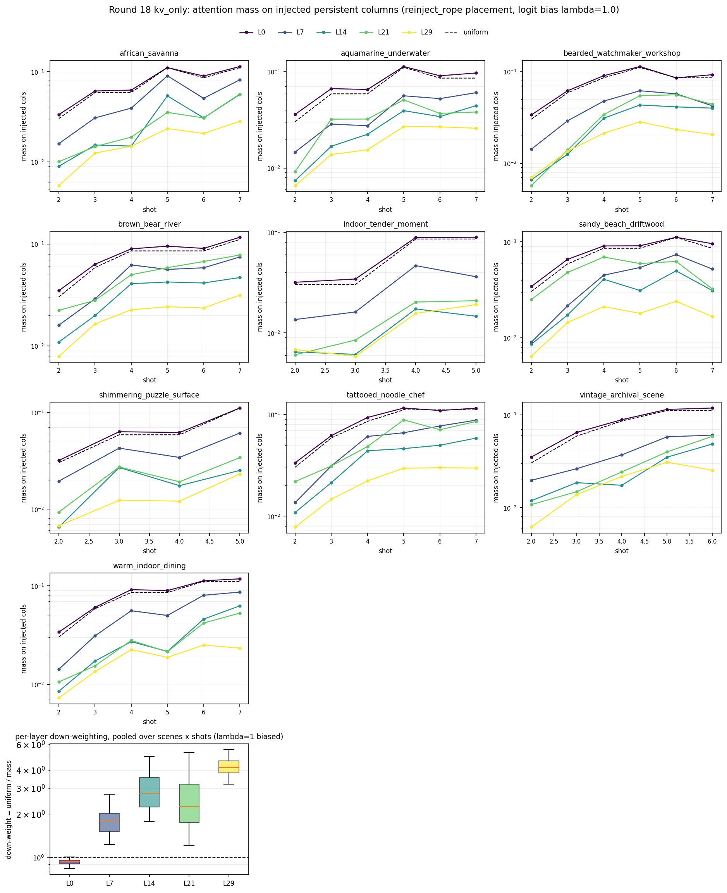

**降权的主因是 recency 垄断,所有"过去"一视同仁。** 镜头边界处,正在生成的
当前块拿走 66–84% 的注意力;模型自己的 sink、上镜头锚帧、我们注入的记忆一起
分零头,浅层三者被压制到完全相同的程度——外来内容折扣为零:

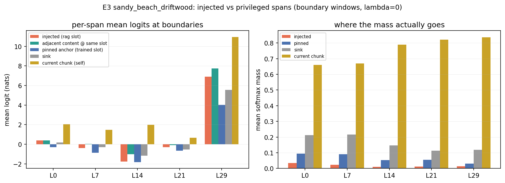

softmax 是零和的:往窗口里塞得更多、选得更准、位置更好,都只是在 15–30% 的
小盘子里重新分配。据此三条路正式关闭:修注入位置(离线反事实上限 +47%)、
修检索选择(锚帧在 key 空间的相似度 0.958,和相邻帧一样,模型眼里本来就是
重复品)、加平坦偏置(λ=1 已实测抬量不抬效)。

**就算读了,也不看主体。** 注入帧每个 token 收到的注意力铺回网格:浅层弥散
扫纹理;中层把整帧压缩成一两个"枢纽 token"读(亮点是均值的 40–100 倍,且
不在鱼身上);深层是噪点。没有一层描出主体轮廓——身份信息在读取端就漏掉了:

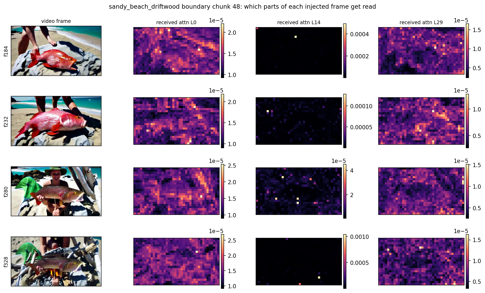

同样的读取模式在人物场景(watchmaker)上复现——中层依旧是枢纽 token 式,
枢纽依旧不在人物脸上,两个场景的关键数字(key 余弦、logit 差)几乎重合:

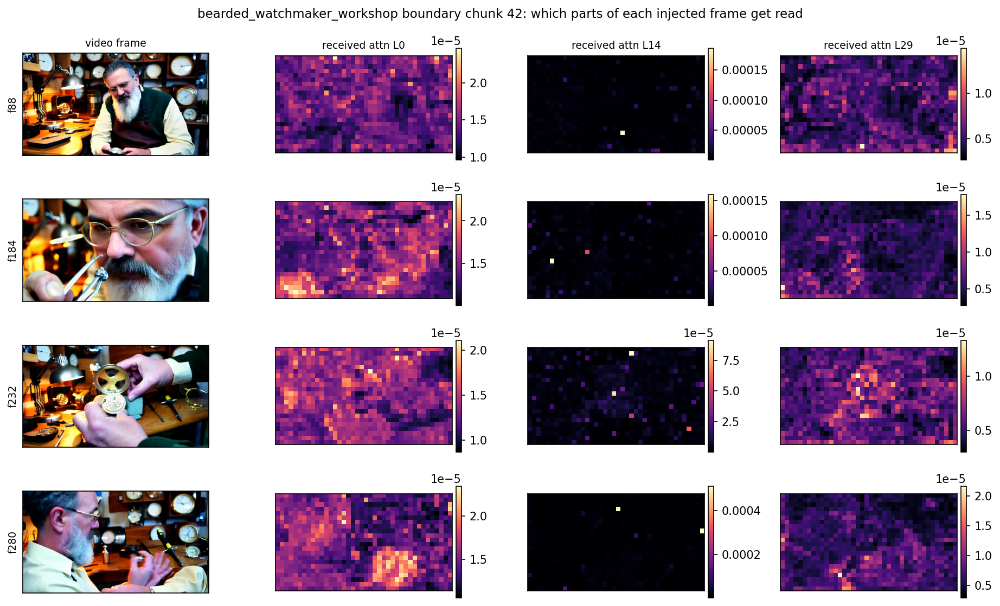

**结论:修复必须"改写内容",不能"追加提醒"。** 要绕开垄断,唯一不和 softmax
竞争的办法是让画面本身携带正确身份——修好的内容就是历史,享受垄断而不是对抗
垄断。这也解释了 LongLive-RAG 论文为什么在同场景有效而跨镜头没人做成:同场景
要的只是场景统计量提醒,小盘子够用;跨镜头身份要强约束,小盘子给不起。

## Part 2:方案 A——用自己的模型擦掉重画

### 原理:一句话和一个类比

Diffusion 模型生成画面的方式是"从纯噪声一步步去噪到清晰",且**大结构先定、
细节后定**。反过来,往画好的画面上加回一部分噪声,就等于把它退回去噪的中间
状态:轮廓和动作还在,颜色纹理等细节被噪声抹掉了。让模型从这个中间状态重新
把去噪走完,细节会被重画——这次我们把正确的身份描述喂给它。类比:给画上
喷一层雾,只留轮廓,让画家照着轮廓重画细节,这次把配色单塞给他。

### 具体步骤(对应管线里的 `edit_renoise` 实现)

以 driftwood 为例:第 4 个镜头(chunk 30–35)里的鱼从红鲷鱼漂成了橄榄灰。

1. **正常重放**。生成是种子确定性的,重放到目标块得到的就是原始画面的
   latent(模型内部的压缩画面表示,每块 8 帧)。这一步免去了存盘。
2. **圈出主体**。用 CLIPSeg(一个开源的"按文字描述找图中区域"的分割模型,
   输入"fish"输出鱼所在区域)对目标镜头逐帧生成 mask(主体区域的 0/1 掩膜,
   人工抽查验收过,见 [mask 质检图](figures/sdedit_repair/mask_qc_chunk32.png))。
3. **mask 内加噪到 σ**。σ 是噪声强度:带噪画面 = (1−σ)×干净画面 + σ×随机噪声。
   σ 越大退得越狠。入场点取模型自己的 4 步去噪阶梯上的天然档位
   (σ ∈ {0.94, 0.83, 0.63},外加试验档 0.40),保证模型处在它熟悉的状态。
4. **换词重画**。重置文字条件(cross-attention,模型读 prompt 的通道),换成
   强调正确身份的修复文案("同一条鲜红的红鲷鱼,红鳞红鳍……"——顺带把原文案
   里自相矛盾的"棕橙色 rockfish"删掉),沿阶梯把剩余去噪步走完。
5. **背景每步钉回**。每个去噪步都把 mask 之外的 latent 强制恢复为原始值
   (即 inpainting 的标准做法),保证背景和构图逐像素不动。
6. **写回历史(recache)**。修好的块重新过一遍模型的"记忆写入"流程,替换掉
   缓存里画歪版本——后续块看到的历史就是修好的版本。

整个流程一张图(真实中间画面;左下 = σ 入场方式,右下 = 换词的具体 diff):

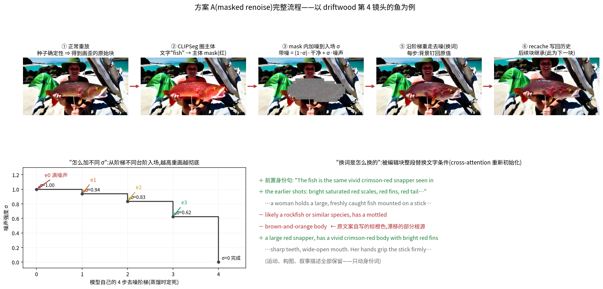

### 为什么判定"通过":预注册规则 + 四条证据

判定规则在实验前定死:存在某档 σ 使"身份显著回升 + 运动构图基本不动",且
健康镜头对照无损伤,则通道成立。四条证据:

**证据 1:σ 剂量-响应存在——效果随噪声深度单调变化,不是运气。**
先说诚实的量级:整帧看差别不明显,得放大到主体特写并配上可量化的颜色指标
(红度 = 主体区域内 R−(G+B)/2 的均值,金帧参考为 98):

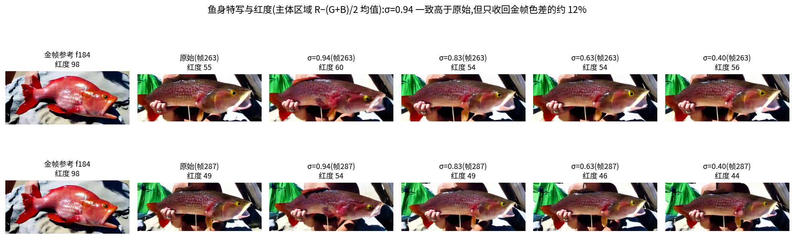

σ=0.94 档的红度在挑出的峰值帧上稳定高于原始(55→60、49→54),其余档在噪声
范围内——方向与剂量关系成立,但单遍 σ=0.94 只收回金帧色差的约 12%。

追加的**满噪声档(σ=1.0,mask 内完全抹掉重画)改写了强度上限**:DINO 身份
0.567 → **0.744(收回 66% 差距)**,红度 55 → 79(收回 56% 色差),鱼身
整体粉红、头形向红鲷鱼靠拢,构图姿态不变。结论修正:文本通道比中档 σ 显示
的强得多——**关键是先把错误内容完全抹掉**,让模型在 mask 内从零重画,而不是
在错误底子上修补。σ=0.94 之所以弱,是错误的旧内容残留在低频里压着新内容。

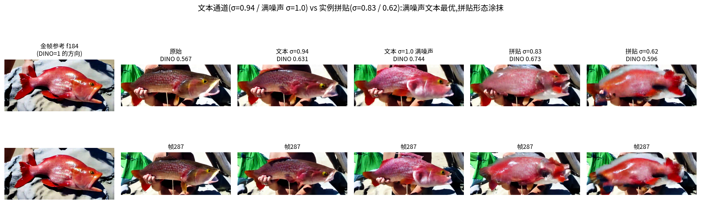

(上图同时包含实例拼贴两臂,见后文"剪贴调和"的实测分析。)
整帧视角的对比(差别较微弱,供完整性):

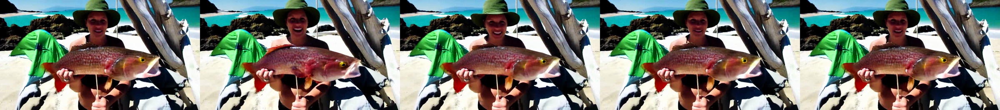

人物场景里 σ=0.94 档的胡子更浓白、更接近人设描述(其余档接近原始):

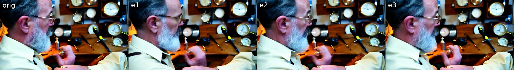

**证据 2:定量指标同向。** 身份用 DINO 度量(自监督视觉模型,输出图像特征
向量;把修复镜头里主体裁剪的特征和"金帧"——同视频里身份正确的参考帧——做
余弦相似度);运动用 RAFT 度量(光流模型,输出画面运动量,防止"把视频修
冻住"这种作弊):

| 臂 | σ | 身份 原→修 | 运动 原→修 |
|---|---|---|---|
| 鱼 · 最强档 | 0.94 | 0.565 → **0.631**(+0.066) | 8.9 → 10.7 |
| 鱼 | 0.83 | 0.565 → 0.581 | 8.9 → 8.2 |
| 鱼 | 0.63 | 0.565 → 0.550 | 8.9 → 8.3 |
| 鱼 · 试验档 | 0.40 | 0.565 → 0.572 | 8.9 → 8.6 |
| 钟表匠(人物细节) | 三档 | +0.014 ~ +0.020 | 5.1 → 7.3~8.9 |
| 健康镜头对照 | 0.83 | 0.834 → 0.855 | 4.2 → 5.0 |

身份增益与 σ 同向、最强档收回与金帧差距的约 1/4;运动最多 +20%(增而非冻,
比"冻结换一致性"的作弊方向健康)。逐帧对比条:

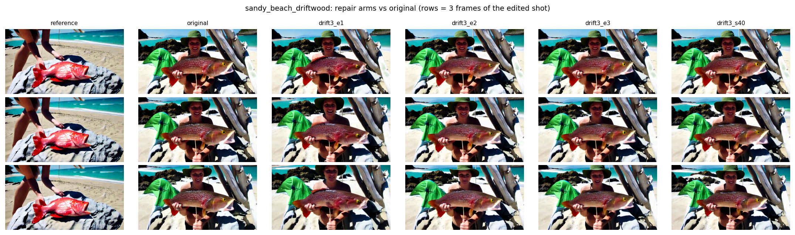
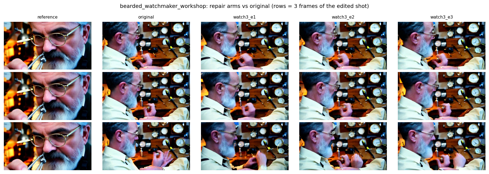

**证据 3:改动确实只落在主体上。** 干净的背景锁定检验(编辑首块和原始逐像素
比):mask 内平均像素差 25.4,mask 外只有 4.7(VAE 解码的轻微渗漏)。
背景、人物、构图逐帧保持。

**证据 4:对照组无损伤。** 把同样的编辑流程施加在一个本来健康的镜头上
(shot2,鱼还是红的),身份 0.834 → 0.855,不降反微升,画面几乎逐像素一致:

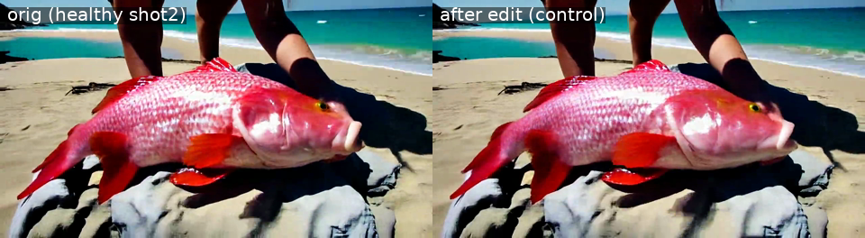

这条排除了"编辑本身会破坏画面、收益只是均值回归"的解释——流程对好内容
是无害的,只对坏内容起作用。

### 如果换词拉不回 golden:失败分型与升级阶梯

单遍文本修复只收回部分差距,这不是终点而是分诊的起点。文本拉不回有三种
本质不同的原因,对策完全不同:

**分型 a:强度不足**——文本方向对,但噪声太浅/只走一遍,修复量小。对策是
工程性的:满噪声档(σ=1.0,mask 内完全重画——**已实测,DINO 0.567→0.744,
收回 66% 差距,是目前单项最有效的杠杆**)、双遍编辑、编辑段加大文字引导。
这些提升文本通道的利用率,但突破不了它的带宽。

**分型 b:带宽不足**——要修的东西文本根本表达不了。"红色"说得出,红鲷鱼的
头形、一张具体的脸说不出;golden 帧里的实例信息不在语言可表达的空间里。
对策是把 golden 的信息以**图像/latent 形式**注入,按成本排:

1. **剪贴调和(cut-paste-SDEdit)——已实测,v1 失败,原因查明**:把 golden
   主体的 latent 区块(从重放中现场截留,零 VAE 编解码)按 bbox 缩放翻转
   贴进目标帧,替代纯噪声作初始化,中等 σ 调和。实测(σ=0.83 / 0.62):
   DINO 0.673 / 0.596,均低于满噪声文本的 0.744;目检可见形态涂抹和鬼影
   (见上方带宽对比图)。失败原因三条:(a) **中等噪声只能调和接缝和光照,
   调不动解剖结构**——donor(平躺岩石上)与目标(被手举着)姿态不同,bbox
   缩放级的粗对齐留下错位的低频几何,中 σ 只能把它抹花,不能重排;
   (b) σ 的两难:调和需要更深的噪声,而更深的噪声会把贴进去的实例信息
   本身抹掉——朴素拼贴在这个 trade-off 里没有甜点区;(c) 单帧 donor 复制
   到 48 个运动帧,引入时间不一致,去噪后表现为涂抹。随后补测了**零噪声极端(cpfreeze)**:贴片核心完全不加噪声钉死
   (保持金帧原样),只让模型在 σ=0.83 下重画接缝环。结果 DINO 0.696、
   红度 92(基本金帧水平)——颜色/纹理保真登顶,但整体身份仍低于满噪声
   文本的 0.744:目检可见轮廓鬼影、头部糊化、贴片与手部光影不贴合。
   **零噪声修好了"贴片被噪声毁",但也永久冻结了几何错位——不给噪声,
   模型就无权修正贴片与场景的关系。**

   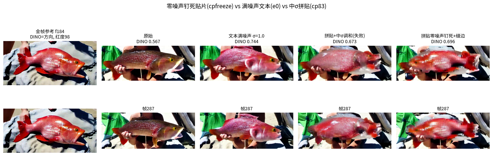

   至此噪声旋钮在贴片家族上全程扫完(0 / 0.62 / 0.83),trade-off 完整
   成形:**噪声是"保真 vs 协调"的调节旋钮**——零噪声高保真低协调(0.696),
   中噪声两头不讨好(0.596–0.673),而纯文本满噪声中保真高协调(0.744)
   综合最优。朴素贴片家族正式出局:实例注入要赢,必须同时高保真+高协调,
   即需要一个能"理解"参考图而非搬运像素的注入通道——VACE 类参考图
   conditioning,或"贴统计"(AdaIN 式只迁移颜色统计,几何全交模型,与
   满噪声档天然兼容,是零训练路线里仅存的候选)。
2. **TI2V 图像条件**:按镜头挂 golden 参考帧(需管线改造,传播测试已证明
   必须逐块作用,故条件要挂在每个被修块上)。
3. **外部编辑模型(VACE)**:参考图 + mask 直接编辑。也是"检索网图做参考"
   的接入点——未见过的角色连 golden 帧都没有,只能靠外部参考图。
4. **V-edit 辅助**:golden 原型差作为方向约束,在模型内部推 V 向量,与
   renoise 叠加使用(通道已验证有因果力)。

**分型 c:先验缺失**——模型根本不会画这个概念。猛犸案例:prompt 说什么都
画成熊,sameshot 实验盲重摇 34 次无效。这类问题**任何编辑都救不了**,
出路只有改写 prompt 绕开先验盲区(sameshot 已证:改写后 40/40 全过)或
训练(LoRA 概念注入)。MovieGenBench 的猛犸修复臂就是这一分型的现场
验证(预期失败,见 Part 4)。

分诊本身是裁判 VLM 的活:它同时看得到"画了什么"和"要什么",判断落在
a/b/c 哪一型、调用哪个工具——这正是 agent 框架"诊断决定动作"的用武之地,
editing 不是一个工具,是一族按分型调度的工具。

### 成本与边界

额外开销约等于重放一个镜头(每块多一遍去噪),零训练、零外部模型。
已知边界:文字通道只能传"可言说"的属性——颜色修得动,红鲷鱼的头形只回来
一部分,人脸胡须等高维身份仅小幅改善(watchmaker +0.02)。高维身份需要
图像级参考(VACE / 检索参考图的接入点)。

## Part 3:修一块能不能管一路——传播测试

如果只修镜头的第一块,靠模型自己的镜头内连续性把修复带完全程,成本可以除以六。
三个追加臂只编辑首块、其余自由延续,逐块测身份:

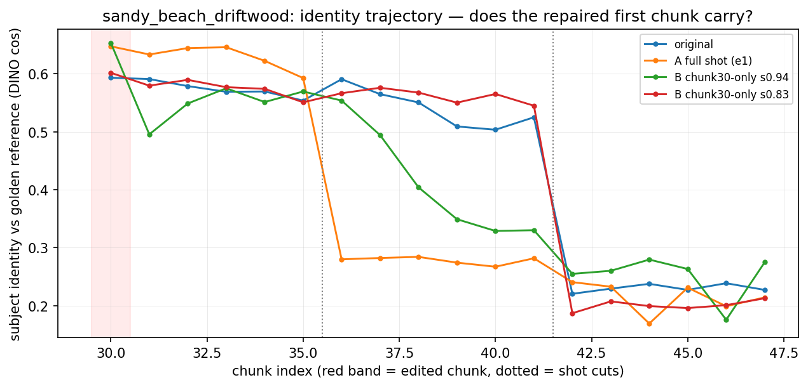

人物场景同样的形态——只修首块的曲线很快回落,全修的保持到镜头结束:

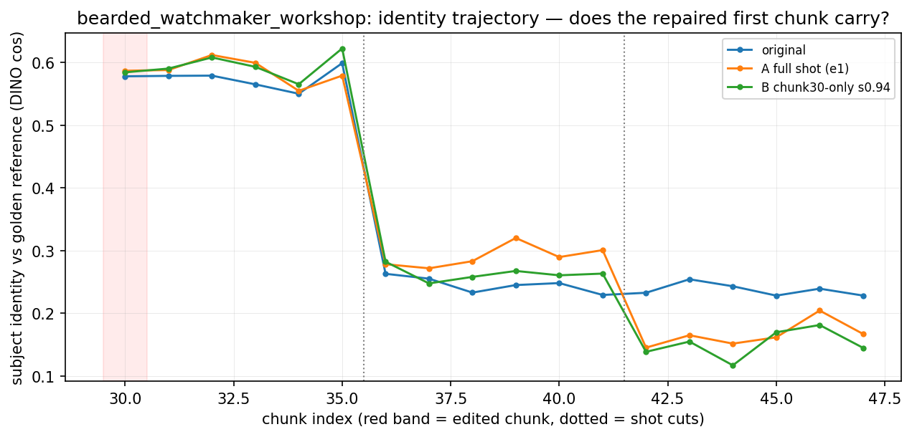

**判定:传播不可依赖。** 修复的自由传播半衰期只有 1–2 块(约半秒)。这是
"窗口通道弱"的第三次独立证明(前两次:跨镜头注入、锚帧钉入),与 Part 1 的
机理完全一致。修复必须逐块直接作用于内容,恰好是方案 A 的形态。

**意外发现:编辑的蝴蝶效应。** 轨迹图里 A 全修在镜头切换后骤跌,目检真相是:
修复版的下一镜头里鱼被放进了火堆——叙事上完全合理(剧本即"抓鱼→备柴→烤鱼"),
但主体从画面中消失。改写一个镜头会不可预测地改变后续镜头走向,所以编辑之后
后续镜头仍要逐一过裁判——恰好是 agent 验收环已有的设计,编辑工具天生不能独立使用:

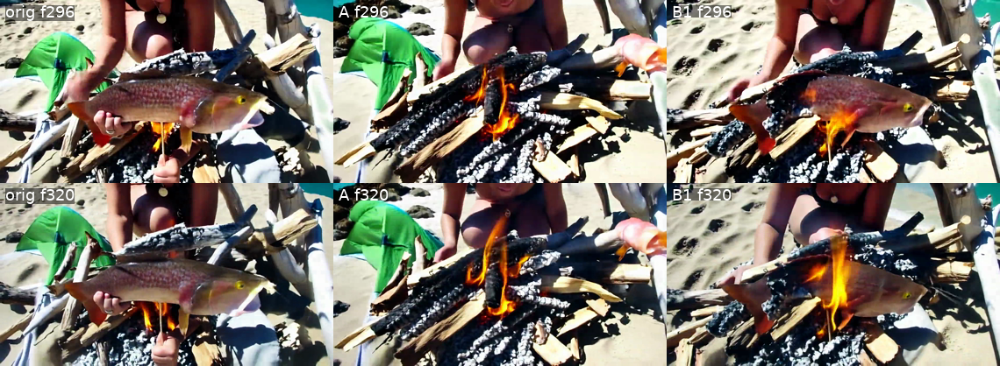

## Part 4:MovieGenBench 上的例子(LongLive-RAG 论文同款 benchmark)

为了不局限于自建 benchmark,从 LongLive-RAG 官方仓库拿到他们评测用的 128 条
MovieGenBench prompts,选四条有明确主体的做单 prompt 连续 20 秒生成(与他们
的评测设定同构),再用方案 A 修复各自的故障段。四条基线恰好构成一个故障分类学,
修复结果也各自对应一个分型:

### 例 1 凤冠鸠——主体细节退化,修复成功

基线后段冠羽结构散乱、红眼出现白圈。对后段(chunk 45–50)做主体 masked
renoise(σ=0.94,修复文案强调"lace-like crest、striking red eye"):

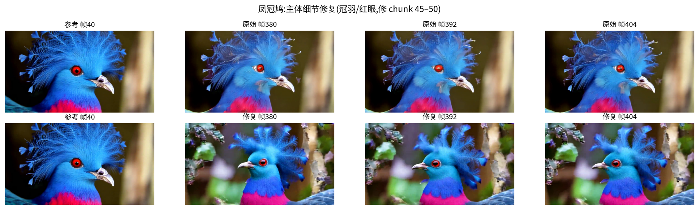

修复后冠羽重新成为带白尖的蕾丝状、红眼环和瞳孔恢复、胸羽回到饱和的品红——
主体修复在他们的 benchmark 素材上同样成立。注意背景也变了:修复段内的后续块
从修复后的历史延续(蝴蝶效应的又一例,叙事合理但不可预测,复核环负责把关)。

### 例 2 东京街道——背景崩坏,部分成功

这条的故障与众不同:主体(红裙女子)全程稳定,**背景**在 10 秒后融化成抽象
光带隧道——正是 LongLive-RAG 瞄准的同场景误差积累。方案 A 反向使用:mask
取反,人物钉死,只重画背景(占画面 86%):

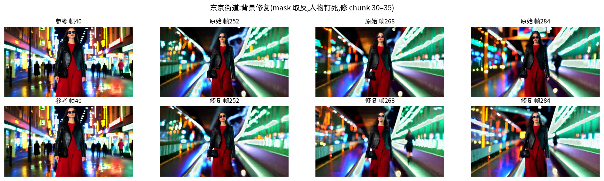

修复段里行人重新出现、街道结构部分回归,但融化的光带大体仍在——**崩坏太彻底
的背景,σ=0.94 的文本修复不够**,需要满噪声档(σ=1.0)或更早介入(裁判在
崩坏初期就该触发修复,而不是等 10 秒)。定位为部分成功。

### 例 3 猛犸——先验缺失,预期失败得到验证,外加一个意外收获

模型从第一帧就把猛犸画成棕熊(先验里没有这个概念),后段还叠加了炫光伪影
积累。修复文案写明"MAMMOTHS, not bears: long curved white tusks, trunks…",
σ=0.94 重画:

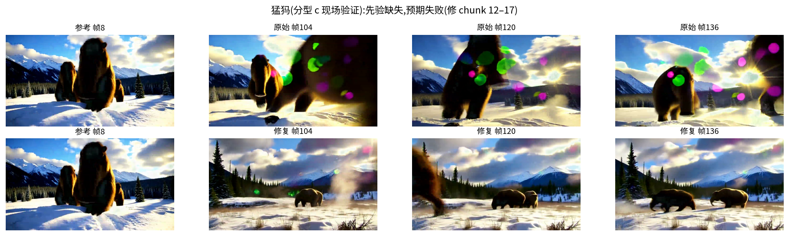

**熊还是熊**——没有长出象牙和长鼻,分型 c(先验缺失编辑救不了)在他们的
素材上现场坐实,和 sameshot 实验"盲重摇 34 次无效、改写 prompt 才 40/40
全过"互为印证。意外收获:修复过程把积累的绿粉色炫光伪影清干净了,场景
质量反而恢复——masked renoise 顺带是一个不错的"去伪影修复器",这是
计划外的观察,值得单独一测。

### 小结

| 例子 | 故障类型 | 修复结果 | 对应分型 |
|---|---|---|---|
| 凤冠鸠 | 主体细节退化 | 成功(冠羽/红眼/胸羽恢复) | a:强度足够时文本可修 |
| 东京街道 | 背景崩坏 | 部分(行人回归,光带仍在) | a:需更深 σ 或更早介入 |
| 猛犸 | 先验缺失 + 伪影 | 身份失败(如预期);伪影意外清除 | c:编辑救不了,归 prompt-rewrite |
| (红鲷鱼) | 跨镜头身份漂移 | 成功(σ=1.0 收回 66%) | a 为主 |

对比视频:`videos/mgb_repair_20260821/*/`(各例修复渲染)与 `baseline/`(原始)。

## 路线图

- **确定的工具形态**:逐块 masked renoise(方案 A)作为 `edit_shot` 动作接入
  agent 验收环——裁判判漂移 → 触发编辑 → 复核 → 提交或隔离。
- **两个便宜的强化杠杆**:编辑段提高文字引导强度;双遍编辑。
- **高维身份的接班人**:人脸/形态类修复接 VACE(参考图+mask 的开源编辑模型),
  也是"检索网图做参考"提案的接入点——文字管粗属性,图像管高维身份,裁判决定
  用哪个。
- **顺带修掉的坑**:driftwood 漂移的部分根源是分镜文案自相矛盾(shot3 文案
  自己写着"棕橙色 rockfish")——文案审查门需要覆盖跨镜头一致性。

## 资产清单

```
机理研究      docs/attention-downweighting-study.zh.md(11 图)
修复实验      docs/sdedit-repair-pilot.zh.md
对比视频      videos/renoise_edit_20260821/eval/*_2up.mp4(左原右修)
探针/编辑代码 utils/kv_rag.py(attn_probe)· pipeline/causal_diffusion_inference.py(edit_renoise)
分析脚本      scripts/analyze_attn_probe.py · analyze_injected_frame_structure.py
              · evaluate_renoise_edit.py · evaluate_scheme_b.py
成本          全天约 5 GPU 时(含等卡自动化)· 零训练 · 零外部模型
```
