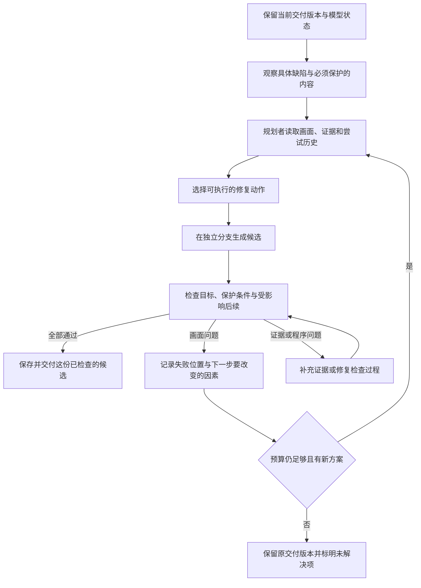

# Humanize 2 深读：怎样让视频修复越试越好

核查日期：2026-09-14（洛杉矶）。本次阅读官方最新主分支源码、流程说明和我们现有实现，并提取已有运行日志；没有运行 Humanize、重跑视频实验或修改修复代码。

## 结论先说

值得借鉴。最有价值的部分是：**把失败变成下一次可执行的改动，把经过验证的成果保存下来，并用固定成本检验这套循环是否有效。**

我对“加两个模型互相检查，就能稳定自我改进”的判断要收紧：这几个流程没有展示模型权重的自我训练；它们改进的是代码、证明等任务产物。进步依赖执行能力、反馈质量和验收规则同时成立。对视频，这三件事都更难。

对我们最直接的建议是：先校正失败反馈，再让一个修复规划角色利用反馈选择下一步；保留现有分支、隔离和前瞻机制。新增一个始终在线的模型裁判、堆积经验库、增加重试次数，都还不是有证据支持的首选。

## 1. 这次核查的版本

| 来源 | 本次从 GitHub 主分支取得的提交 | 提交日期（UTC） | 阅读重点 |
| --- | --- | --- | --- |
| [Humanize 2](https://github.com/humanfia/humanize2/commit/040be01a56d2c7d5fe04727381e64ecb68de8fbc) | `040be01a56d2` | 2026-09-02 | 会话、流程运行、恢复、预算 |
| [官方 Flowverse](https://github.com/humanfia/flowverse/commit/275d7a167c213bd7e310f0707d93c172337c904a) | `275d7a167c213` | 2026-09-13 | RLAR、Flame Chase、并行 Git/PR Lite、递归 Lean 流程 |

Humanize 2 的运行命令是 `hmz`；流程代码在独立更新的 Flowverse 中。因此只看旧 Humanize 仓库，甚至只看新版运行器 README，都会漏掉关键变化。下文的源码链接固定到本次提交。

## 2. 他们实际上有几种不同的“自我改进”

### 2.1 RLAR：作者记得工作经过，审查者重新检查成果

实际循环是：作者工作 → 新审查会话检查当前仓库 → 返回 `done` 和 `notes` → 未完成就把 `notes` 原文交给作者。

作者在连续运行时保留会话；审查者每轮新开会话。恢复一次被中断的运行时，会重新给作者任务和尚未处理的那条审查意见。持久状态主要是轮次与最后一条未处理反馈。两个角色可以使用同一个模型。[RLAR 源码](https://github.com/humanfia/flowverse/blob/275d7a167c213bd7e310f0707d93c172337c904a/flows/rlar/__init__.py)

这个设计对我们有用的地方：反馈应指出具体失败和下一步，例如“第 3 镜头新增了角色，但原来在场的人消失了”，而不只是“不通过，请重试”。作者得到完整反馈，才有条件改变方法。官方也专门强调中间摘要会丢掉关键失败证据。[官方解释](https://humanfia.ai/blog/2026-08-17-the-review-is-the-next-prompt)

但需要分清保证的范围：结构化 `done` 防止程序读错结论，不能防止模型判断错误；新会话减少历史叙述的影响，不能消除同模型的视觉盲点。这个流程本身也没有统一的机器验收器替代审查者的判断。

### 2.2 基础 Flame Chase：两个人轮流尝试

基础实现很短：两位 agent 轮流接到同一任务，每轮新开会话，通过当前仓库接续工作。保存轮次和下一个轮到谁，由运行器预算限制运行。代码没有通用的“测量质量、保存最佳、失败自动回滚”机制。[基础流程源码](https://github.com/humanfia/flowverse/blob/275d7a167c213bd7e310f0707d93c172337c904a/flows/flame_chase/__init__.py)

官方内核优化教程把“跑测试、测耗时、只留下正确且更快的改动”写进具体任务。这能说明一种用法，但不能推出所有任务都能靠轮流工作稳定提升。[教程](https://docs.humanfia.ai/humanize2/user/tutorials/take-home)

对视频的对应做法是让不同尝试检验不同修复假设，并明确保留规则。只轮流改写 caption，并不能保证比多抽几个随机种子更有效。

### 2.3 Git/PR Lite：一个会改变建议的新发现

最新版的 `parallel_flame_chase_git_pr` 固定采用 Lite 配置：一位初始规划者，三条尝试路线，每条路线两位 agent 交替工作；没有专职 reviewer 槽位，关闭额外的 Global Knowledge 和 Experiment Memory，仍保留报告共享。[配置与说明](https://github.com/humanfia/flowverse/blob/275d7a167c213bd7e310f0707d93c172337c904a/flows/parallel_flame_chase_git_pr/README.md)

它的关键在提交环节。运行器核对评测回执是否属于这次冻结的候选版本、输出日志是否匹配、评测是否成功，并按内核耗时选择改善候选。最终发布的文件树必须与已测试的文件树完全一致。该快速路径不再调用模型审查或进行一次 staging 重测。[候选选择实现](https://github.com/humanfia/flowverse/blob/275d7a167c213bd7e310f0707d93c172337c904a/flows/parallel_flame_chase_git_pr/runtime.py#L748)、[提交保护实现](https://github.com/humanfia/flowverse/blob/275d7a167c213bd7e310f0707d93c172337c904a/flows/parallel_flame_chase_git_pr/pre_receive.py#L77)

这给我们的启发是：**提出方案、解释失败、决定是否交付，是三个职责。** 有清楚可信的测试时，最后一个职责可以由程序承担。

它没有证明“裁判和记忆都没用”。README 称该配置在一次 12 小时实验里最好；本次没有找到足以独立核实优势的完整对照数据。该选择器又依赖内核任务的 cycles 指标，不能直接换成一个视频 VLM 分数就宣称具有相同可靠性。回执能保证“交付的是被测版本”，不能保证“测试测对了用户想要的东西”。

### 2.4 递归 Lean：把局部失败和组合失败分开

它保存已验收的子证明，合并时失败就进入专门的整合修复，不把已解决的问题全部推倒重来。说明文档还要求组合后的成果重新经过机器检查。[流程说明](https://github.com/humanfia/flowverse/blob/275d7a167c213bd7e310f0707d93c172337c904a/flows/recursive_lean_prover/README.md)

视频可以借鉴这种失败分类：当前镜头修好了、后续镜头变差，说明局部方案有价值，但整条分支尚未合格。应保留候选及失败证据，让下一次尝试利用它。视频镜头之间还有模型内部状态和视觉连续性依赖，不能把几个局部“通过”的片段直接拼成最终结果。

## 3. 对照我们：已有基础与真正缺口

| 环节 | 当前实现 | 应补的能力 |
| --- | --- | --- |
| 结构化审查 | 已有 `Verdict.accept`、逐项约束和证据 | 校准判断、区分错误类型，避免把技术报错当画面退步 |
| 分支安全 | 已有快照恢复、候选隔离、可信参照来源、前缀检查 | 确保反馈历史也有明确的分支和来源 |
| 后续检查 | 已比较候选与父分支的未来受影响出场，检查具体约束 | 失败后在剩余预算中调整方案，而非直接结束 |
| 修复规划 | demo 使用 `AbstainingController`，主要动作由 verifier 给出 | 让规划角色综合失败画面、动作历史、保护条件与预算 |
| 缺席重试 | 最新缺席/在场名单、位置关系、前几次 caption | 前次为什么失败、哪里被改坏、后续出现什么问题 |
| 执行器 | 属性区域重画；缺席时改写 caption 整镜头重采样 | 单独验证现有动作能否完成目标；必要时再研究新的控制方式 |

源码位置：[demo 组装](../scripts/run_agent_edit_demo.py)、[运行器](../utils/agent_runtime.py)、[实体裁判](../utils/agent_entity_judge.py)、[提示词改写](../utils/agent_prompt_rewrite.py)。

### 缺口一：反馈还不足以指导下一次动作

`AbsentEntityPromptRewriter.rewrite` 的模型请求里 `image_paths=[]`。它确实会收到本轮识别出的缺席/在场名单和之前写过的 caption，所以并非完全重复；但没有修前修后画面，也没有前瞻失败证据。它主要被要求“换一种说法”。

对 Humanize 的适配应该是：把完整审查证据交给能看图、能选动作的规划模型，再把动作编译成合法的 prompt、mask、sigma、seed。直接把一长段批评塞进扩散模型的 caption，没有同样的意义。

### 缺口二：未来失败没有进入下一轮学习

`run_shot` 在当前镜头通过后立即返回 `_commit_accepted`。后者若遇到前瞻失败，会恢复父分支、记录回退并返回；不会回到当前镜头的编辑循环。

本次读取已有缺席实验的 9 份 ledger，提取到 4 次前瞻拒绝，发生在编辑 attempt 1、1、2、2。它们证实了实际运行经过这条退出路径。不能把“回退保护有效”直接当成“修复循环已经充分利用反馈”。[可复查的日志提取](humanize2-review-20260914.guard-audit.json)

### 缺口三：日志中的“退步”混有比较程序错误

这次发现一个更具体的问题。约束构造把观察得到的 `comparison_basis` 写进固定约束的 `parameters`；人物未找到时它可能为空，找到后变成脚本描述或参照图。比较器又要求两边的约束定义完全一致，于是把这种变化记成定义改变并拒绝。[约束构造与比较](../utils/agent_constraints.py)

在 `ns060` 的两条回退记录中，Luna 的外观状态从 `unknown` 变成 `satisfied`，同时却被列进 `regressions`，理由是参数定义变化。这里混淆了“该满足什么要求”和“这次观察用了什么证据”。后者变化不应自动代表要求改变。

**不能据此推翻四次回退。** 四条记录都有其他拒绝依据：例如 Miles 从被判定在场变成缺席，或原来成立的出场证据丢失。实际画面是否变差还需要独立视觉复核。本次能确认的是失败报告混入了比较错误；尚不能说修正它会增加多少真实成功案例。

### 另一个静态风险：检查过程会修改改写历史

`EntityDriftVerifier.snapshot_state` 保存参照和轨迹，未包含 `_rewrite_history`；`_regenerate_verdict` 会写入这个历史。前瞻会调用 verifier，因而存在“只是在检查未来，却生成了修复建议并影响后续历史”的状态边界问题。这里是源码静态风险，未做运行复现。

建议把“观察并判断”与“为准备编辑的镜头制定动作”分开。失败经验可跨尝试保留，但必须标注它来自父分支、候选分支还是前瞻试算；它与可信身份参照不能共用含糊的状态生命周期。

## 4. 为什么视频不能照搬内核优化的成功逻辑

### 4.1 好的评语不等于可执行的修复

代码 agent 可以直接改一行程序。视频模型接受 mask 和文本后，结果仍有随机性，也可能无法按要求长出缺失角色。两个规划模型都说“把 Iris 加回来”，不会自动增加生成器的控制能力。

要分别问：在允许动作和预算内，是否生成过真正合格的候选？如果有，规划/筛选是否找到并留下它？前者长期为否时，应研究执行器；后者失败时，应研究反馈和验收。参考图条件或 KV 写入只能作为待验证的新能力，不能当作现成接口。

### 4.2 视频裁判存在看不到的维度

我们当前的外观比较器明确忽略动作、姿势、镜头和背景。这适合回答“角色外观是否一致”，不足以回答“整段视频是否修好”。颜色对了但身份变了、人物出现了但动作没了，都需要其他证据。[外观比较器](../utils/agent_appearance_evidence.py)

验收应围绕具体目标与保护条件：缺的人出现、原来的人保留、身份不被替换、关键动作和连续性仍成立。已实现的逐项约束值得沿用；尚未覆盖的维度要先校准，不能拿几个任意阈值拼成“可靠裁判”。

### 4.3 重试越多，也越容易挑中裁判误判

如果反复生成、反复按同一 VLM 的高分挑选，可能逐渐选到它喜欢但人看着更差的结果。这是基于有噪声选择过程的推断。新审查会话不能解决共同视觉盲点；换模型也需用标注对照验证。

因此，开发时要保留没有参与反复调试的评测样本，并对成功候选做独立复核。对可疑案例再增加证据，例如多看一些时刻或交换修前修后展示顺序；这些也要计算成本，不能把复核次数当成免费收益。

## 5. 我建议的视频修复循环

**模式边界（具体接口复核后补充）：** 下图中把后续失败交回当前镜头规划者的路径，应实现为明确的离线修复模式。现有 `ShotContext`、时间输入审计与运行器注释要求未来预览不进入当前控制上下文。新模式需要记录修复目标镜头与实际已观察到的最远镜头，给预览证据标注分支和来源；不能绕过审计，或把未来信息藏进普通字符串后仍按当前镜头上下文调用。严格逐镜头因果的实验只能使用当前和过去的证据规划；它与使用后续反馈的版本应分别报告结果。

所有路径都受总预算约束，包括补证据和检查重试。预算耗尽意味着停止，不代表任务成功。

### 规划者每轮应拿到什么

- 原始任务、可信角色参照、修前与修后对应画面。
- 哪个要求失败，以及证据所在的镜头、时刻和角色。
- 前几次动作和结果：修好了什么、改坏了什么、哪些结论不确定。
- 允许使用的动作、参数范围与剩余成本。

### 规划者每轮应交出什么

- 本轮主要修复目标和必须保护的内容。
- 一个可执行动作，及与前次相比改变了哪个因素。
- 成功时预计能观察到什么；需要检查哪些受影响后续。
- 如果判断当前动作能力不足，明确停止或转入能力实验。

例如：上一轮整镜头重画后，Iris 被判定出现了，但 Noah 在后续镜头丢失。下一步应针对保持 Noah 与控制后续影响提出可执行方案；如果现有工具只能再次整镜头随机重画，就如实记录这一限制，不能把更长的文字说明当作新增能力。

### 怎样保存进展

已验收版本保存画面及继续生成所需的 latent/KV 状态、prompt、随机种子、代码和模型版本、裁判证据。候选失败时保留短而具体的实验记录，不把它的外观加入可信身份参照。

“这次失败了”不能立即升级成跨场景的普遍经验。一条经验应注明适用条件、支持样本与反例；检索实验事实应先于让模型不断总结长篇经验。

## 6. 最小验证顺序

### 第一步：清理反馈，不改成功标准

先处理约束定义与观察证据混淆，给拒绝原因区分画面退步、证据不足、比较错误、服务错误。检查前瞻对规划状态的副作用。不能通过放松已有防退步规则让成功数变好看。

用现有日志检验修正后的分类。尤其追踪上面四次回退：删去比较错误后是否仍有合理拒绝依据。没有独立视觉复核的记录，继续标为裁判判断。

### 第二步：固定成本，只比较“反馈是否改善规划”

| 组别 | 做法 | 保持一致 |
| --- | --- | --- |
| A | 现有规则动作与 caption 改写 | 视频模型、可用动作、验收规则、场景和起始状态 |
| B | 规划角色读取失败画面和证据，再从同一动作集合选择 | 同一套资源成本核算；包括额外 VLM 调用和后续生成 |

先用同一 VLM 承担不同角色，减少模型差异的混杂。之后再单独比较换模型或多路线搜索的收益。不能同一轮同时换裁判、换 mask、换生成模型，再把提升归因于双 agent。

样本应包括本来正确的对照、属性走样、角色缺席和局部通过但后续失败的场景；开发集用于调试，最终留出样本不参与反复改方案。对随机生成采用多个种子，保留全部失败与超时。

重点记录：

1. 真正修对且没有新增问题的比例，以及独立复核的误通过率。
2. 原本正确的视频被误改坏的比例。
3. 局部成功后因后续影响回退的比例，以及下一轮是否减少同类失败。
4. 每个真实改善消耗的 GPU 时间、VLM 调用成本与总时间。
5. 整场景收益及不确定性；另外记录候选池里是否曾存在被漏掉的好结果。

### 第三步：根据瓶颈选方向

- 反馈明确却始终生成不出好候选：优先研究生成控制能力。
- 有好候选但选错、拒错：优先研究验收与证据。
- 有能力、有判断，但反复犯相同错误：优先研究规划策略和实验记忆。
- 单路线容易卡住且不同方案确实互补：再检验多路线搜索是否值得额外成本。

## 7. 外部证据能支持多强的结论

源码可以支持这些流程确实如何运转，不能独立证明它们比单 agent 更有效。官方 FlowBench 页面截至本次查询仍写着未发布；其目标是固定模型和任务、用真实检查比较不同工作流程。这种实验思路值得采用，公开证据暂不足以推出视频修复的收益。[FlowBench 官方页面](https://humanfia.ai/projects/flowbench)

最终判断：**Humanize 2 最值得学的是让每次失败都帮助选择下一步，并让成果通过可追溯的检查后再累积。我们当前最值得补的是准确的失败反馈与能利用反馈的修复规划；执行器是否修得动、裁判是否看得准，仍要各自拿实验回答。**
