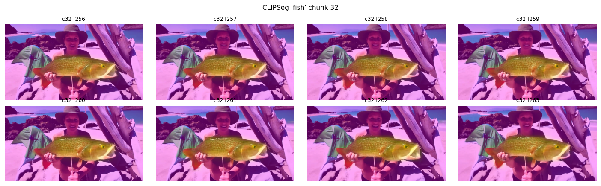

# 用自己的模型修自己的画:masked renoise 修复实验

> **[2026-08-27 标注:本文已过期,只保留作实验记录。]** 后续追加实验改写了两个结论:
> σ=1.0 满噪声档是强度冠军(DINO 0.567→0.744,收回 66% 差距,本文的 σ=0.937 +0.066
> 不再是上限);剪贴调和(cut-paste-SDEdit)家族扫完噪声旋钮后全线出局。up-to-date
> 版本见 [editing-repair-report.zh.md](editing-repair-report.zh.md)。

2026-08-20。注意力降权研究([attention-downweighting-study.zh.md](attention-downweighting-study.zh.md))
的结论是追加式记忆注入到不了主体、改写才是出路。这个实验测改写的第一种执行器:
不引入任何外部模型,用冻结的生成器自己做 SDEdit 式的"擦掉重画"——把画歪 shot
的主体区域加噪回中间 σ,换上强调正确身份的 prompt 重走剩余去噪步,背景 latent
每步钉回原值,修复结果经 clean recache 写回历史。

预注册判定:存在某档 σ 使"身份显著回升 + 运动构图基本不动"则通道成立;全部档位
改不动身份、或改动必毁运动,则宣告失败,转 TI2V 图像条件方案。

## 实现

管线里新增 `edit_renoise` 配置块(pipeline/causal_diffusion_inference.py,默认
惰性):目标 chunk 先正常去噪得到 pass-1 结果(种子确定性保证它就是原视频),
然后 mask 内重加噪到入场 σ、重置 cross-attn 缓存换修复 prompt、沿调度器自己的
σ 阶梯做 Euler 重去噪,每步把 mask 外的 latent 钉回 pass-1 值;编辑后的 chunk
进 clean recache,后续 chunk 自动继承修复后的历史。入场点取 4 步蒸馏阶梯的
自然档位:σ ∈ {0.937, 0.833, 0.625},外加一个偏离阶梯的试验档 0.40。

素材来自 attn_probe 重放(λ=0):driftwood 的 shot3 里鱼从鲜红的红鲷鱼漂成了
橄榄灰(修复目标),watchmaker 的 shot3 修人物细节,driftwood 的健康 shot2 做
无损伤对照。主体 mask 用 CLIPSeg(人工验收过,鱼圈得很准):

一个顺带的发现:shot3 的 authored caption 自己写着"mottled brown-and-orange
rockfish"——这个场景的漂移有一部分就是 authored prompt 的自相矛盾造成的
(Round 18 审查门抓过同类问题)。修复 prompt 除了前置身份描述,还把这个矛盾
短语替换掉了。

## 结果

8 臂全部跑完(4 卡并行 20 分钟)。定量表(身份 = 主体裁剪的 DINO 对金帧
参考集的余弦;运动 = RAFT dynamic degree;carry = 后续 shot 的身份):

| 臂 | σ | 身份 原→修 | 运动 原→修 | carry 原→修 |
|---|---|---|---|---|
| drift3_e1 | 0.937 | 0.565 → **0.631** (+0.066) | 8.9 → 10.7 | 0.378 → 0.257 |
| drift3_e2 | 0.833 | 0.565 → 0.581 (+0.016) | 8.9 → 8.2 | 0.378 → 0.342 |
| drift3_e3 | 0.625 | 0.565 → 0.550 (−0.015) | 8.9 → 8.3 | 0.378 → 0.412 |
| drift3_s40 | 0.40 | 0.565 → 0.572 (+0.008) | 8.9 → 8.6 | 0.378 → 0.420 |
| watch3_e1 | 0.937 | 0.577 → 0.591 (+0.014) | 5.1 → 8.9 | 0.241 → 0.221 |
| watch3_e2 | 0.833 | 0.577 → 0.596 (+0.018) | 5.1 → 7.3 | 0.241 → 0.271 |
| watch3_e3 | 0.625 | 0.577 → 0.597 (+0.020) | 5.1 → 7.6 | 0.241 → 0.259 |
| drift2_ctrl | 0.833 | 0.834 → 0.855 (+0.021) | 4.2 → 5.0 | 0.544 → 0.545 |

肉眼比数字直观。frame 260,从左到右 = 原始 | σ0.94 | σ0.83 | σ0.63 | σ0.40:

σ 响应单调:噪声越深鱼越红,σ=0.94 时鱼身明显回到粉红、红鳍重现,而女子、
帽子、帐篷、浮木、构图在所有臂逐帧不变。干净的背景锁定检验(只看编辑首个
chunk,和原版逐像素比):mask 内 MAE 25.4,mask 外只有 4.7(VAE 解码的轻微
渗漏)——改动确实全部落在鱼身上。

逐臂的并排对比视频在 `videos/renoise_edit_20260821/eval/*_2up.mp4`
(左原始右修复,含编辑段前后各几秒)。

## 判定与解读

按预注册规则,**通道成立**:σ=0.94 档身份 +0.066(约收回原始与金帧差距的
四分之一),运动上升 20% 而非冻结,构图逐帧保持,对照 shot 无损伤(+0.021,
不降反微升)。零外部模型、零训练、单次前向的额外开销约等于重放一个 shot。

三条诚实的保留:

1. **修复是部分的**。DINO 增益 +0.066 对应的主要是颜色回归;纹理和形态
   (红鲷鱼特有的头形)只回来一部分。这符合机制预期——身份信息经 cross-attn
   的文本通道进入,文本能描述颜色,难描述形态细节。
2. **人物细节几乎修不动**(watchmaker +0.02,且运动上升)。和 Round 18 "kv
   对人物细节场景无效"的发现同源:文本通道对人脸/胡须这类高维身份的带宽太低。
   这正是 TI2V 图像条件(方案 B)的用武之地——图像通道的身份带宽远高于文本。
3. **carry 信号噪声大**:σ 越深的臂后续 shot 的指标反而降(0.378→0.257),
   但后续 shot 是火堆特写场景,鱼小而遮挡,主体裁剪本身不可靠;需要人工看
   2-up 的后续段再下结论。修复传播是否成立,本轮不做判定。

## 追加轮:传播测试(方案 B 的零代码近似,同日晚)

只修镜头首块(chunk 30)、其余自由延续,测修复能否靠镜头内连续性免费传播。
三臂(drift3_B1/B2 = σ0.94/0.83 种子,watch3_B1),逐块身份轨迹在
`videos/renoise_edit_20260821/eval/*_scheme_b_trajectory.png`。结论两条:

1. **传播半衰期 1–2 块**:B 臂在修复块身份达到 A 水平(0.653),1–2 块内衰减
   回原始曲线。这是"窗口通道弱"的第三次独立证明(前两次:跨镜头注入、锚帧
   钉入)——后续块读取修好的首块,走的还是被垄断的小盘子。修复必须逐块直接
   作用于内容,即方案 A 的形态;真正的图像条件挂载(管线改造)留作对照。
2. **编辑的蝴蝶效应**:A 全修臂在下一个镜头(未编辑)身份骤跌,目检发现是
   鱼被放进火堆烧掉了——叙事上合理(剧本即"抓鱼→备柴→烤鱼"),但主体消失。
   改写一个镜头会不可预测地改变后续镜头走向,所以编辑之后后续镜头仍须逐一
   过裁判——编辑工具天生不能脱离验收环独立使用。

可展示汇报页(全天三部分,图表嵌入):
https://claude.ai/code/artifact/6ad76084-b12c-4faa-9de5-b240e157a3de

## 下一步

- 提高修复力度的两个便宜杠杆:编辑段用 >1 的文本引导(现在 guidance=1);
  两遍编辑(第一遍的输出再过一遍 σ=0.83)。
- 方案 B 对照:同素材同 mask,用 TI2V 图像条件注入金帧,和 σ=0.94 档比
  身份增益——文本通道 vs 图像通道的带宽差,一张表说清。
- 把 `edit_renoise` 包装成 agent runtime 的 `edit_shot` 动作:裁判判漂移 →
  触发编辑 → 复核 → commit/quarantine,打通"发现-修复-验收"整环。
- carry 的干净测量:后续 shot 换整帧指标 + 人工目检。
